<p align="center">
  
</p>

<h1 align="center">Koda</h1>

<p align="center">
  <strong>Read. Diagnose. Blueprint.</strong><br/>
  Competitive programming training built for a phone — without writing syntax on glass.
</p>

<p align="center">
  
  
  
  
</p>

<p align="center">
  <em>Clear Warm-up → Target → Boss. Build judgment first. Code later on a real keyboard.</em>
</p>

---

## Launch

<p align="center">
  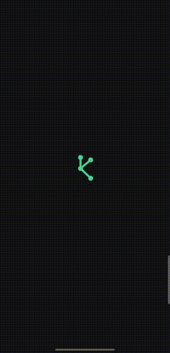
</p>

---

## Run

Home is one composition: wordmark, streak / XP / band, Daily Algorithm, and today’s path.

<p align="center">
  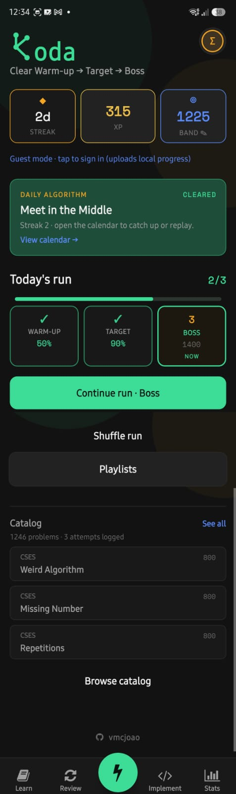
</p>

| Piece | |
| --- | --- |
| **Graph-K wordmark** | Tap to replay the animation |
| **PlayerStrip** | Streak · XP · Band |
| **Daily Path** | Warm-up → Target → Boss |
| **Raised Run orb** | Center tab bolt |

---

## Daily Algorithm

One seeded skill-check a day. Streak, catch-up, calendar.

<p align="center">
  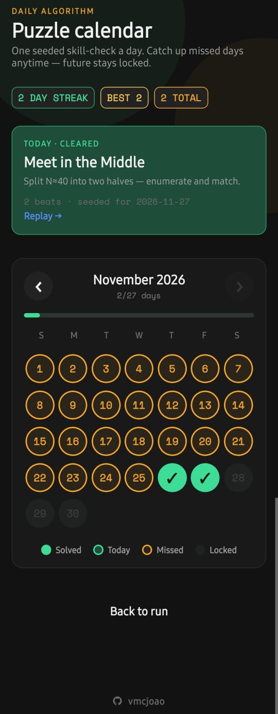
</p>

---

## Learn — Algorithm Dojo

Suggested path, unit progress, Check drills, and **Live Replay** visualizations.

<p align="center">
  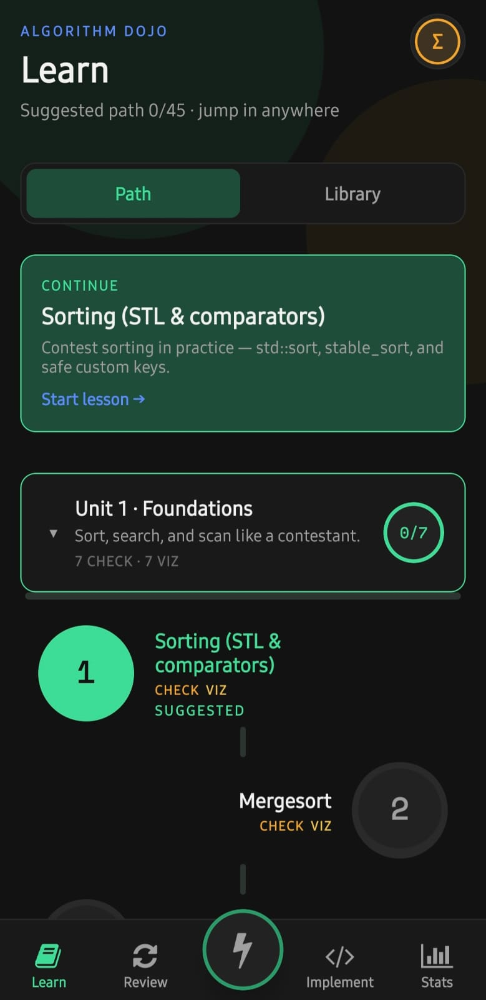
  &nbsp;
  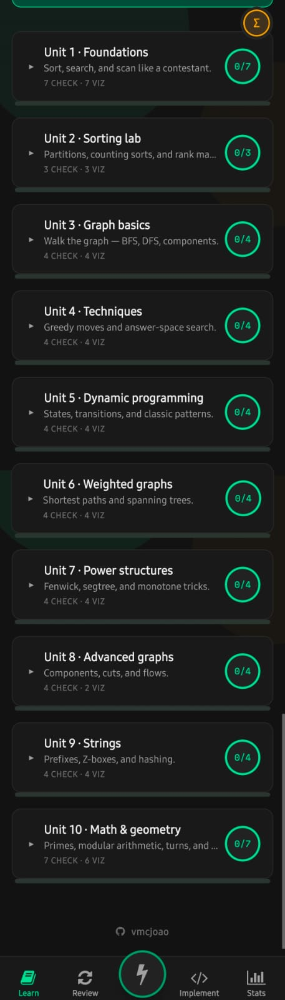
</p>

### Live Replay

<p align="center">
  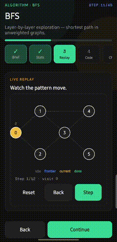
  &nbsp;
  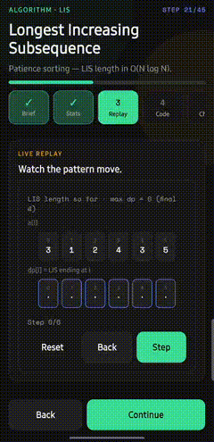
  &nbsp;
  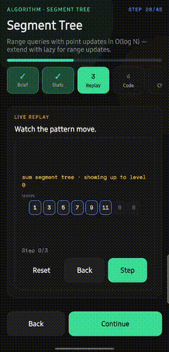
</p>

<p align="center">
  <sub>BFS · LIS · Segment tree — plus knapsack, hull, Dijkstra, and more in-app.</sub>
</p>

---

## Review · Implement

Misses land in the Review deck. Blueprints wait in the Build Queue until you AC them on a real OJ.

<p align="center">
  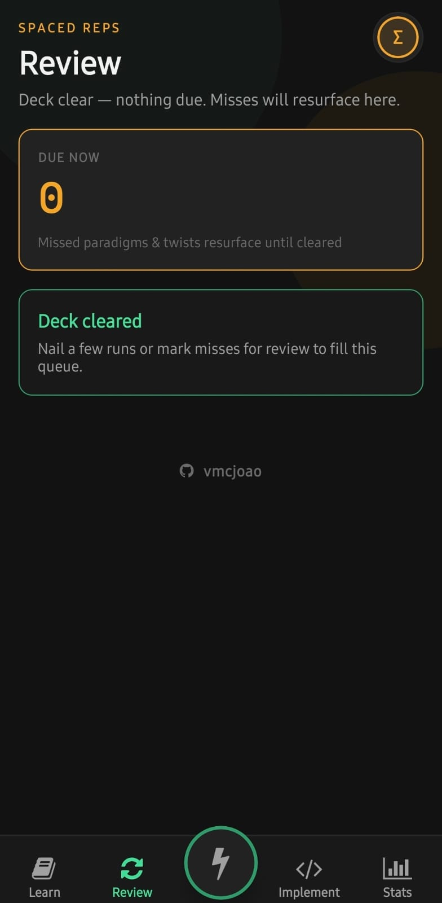
  &nbsp;
  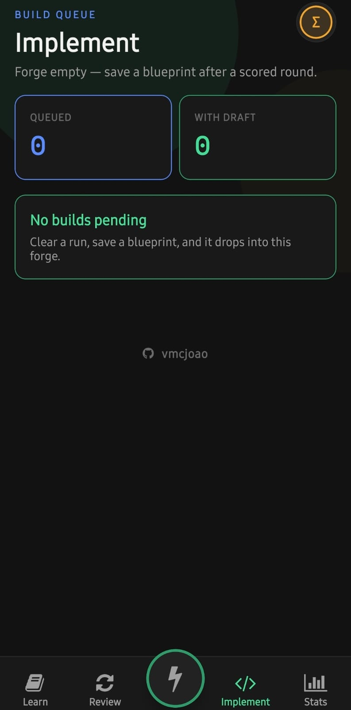
</p>

Core loop:

```text
Encounter  →  Radar  →  Hypothesis  →  Blueprint  →  Reveal
```

---

## Stats

Band, heatmap, diagnose → blueprint → implement pipeline, topic mastery.

<p align="center">
  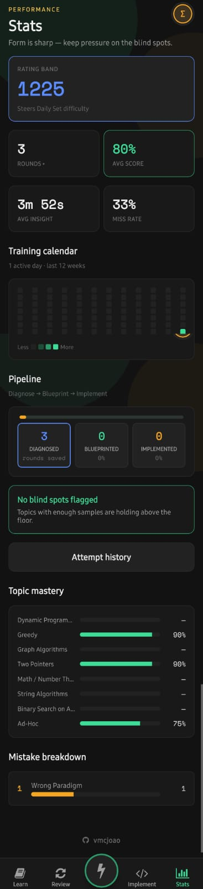
</p>

<p align="center">
  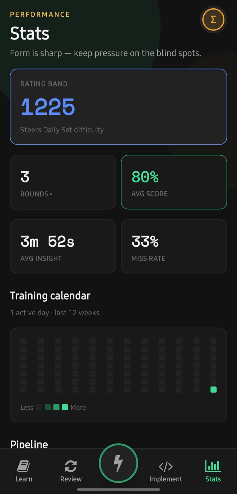
  &nbsp;
  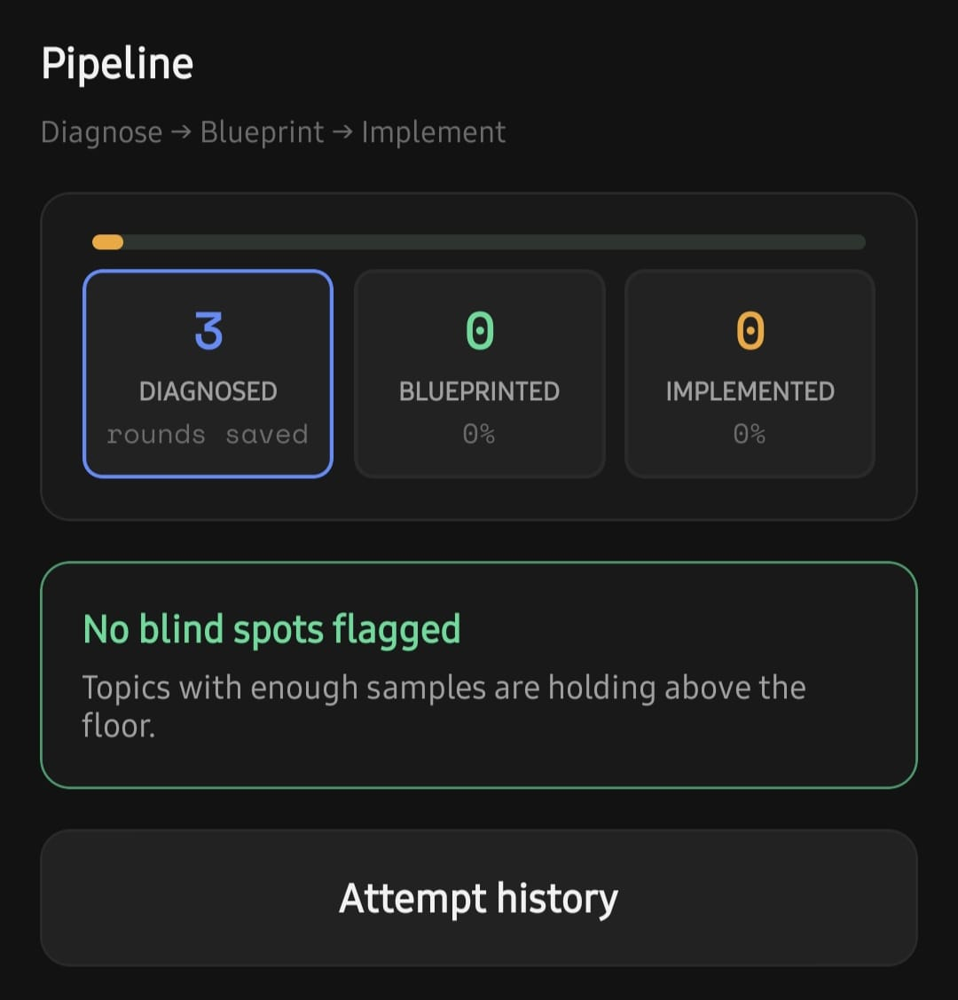
  &nbsp;
  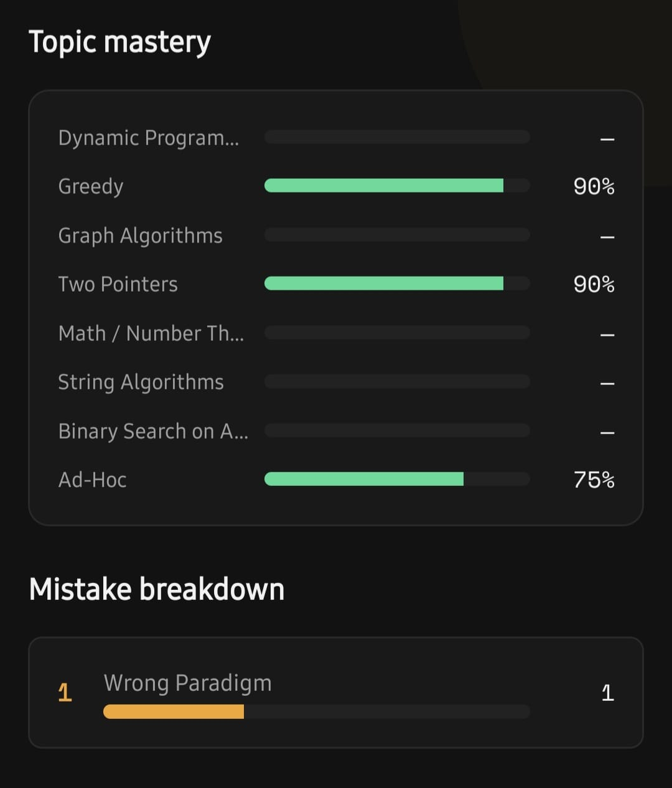
</p>

---

## Why Koda

Most CP apps shove an editor onto a phone. Koda flips it:

1. **Train recognition** — paradigms and twists under time pressure  
2. **Keep implementation for a keyboard** — blueprints land in Implement  
3. **Feel like a run** — daily set, streaks, bands, haptics, motion with purpose  

| | |
| --- | --- |
| **Mint** `#3DDC97` | Accents, Run orb, wordmark |
| **Gold** `#F0C14B` | XP |
| **Amber** `#F5A623` | Streak · Boss · Daily Algo |
| **Radar blue** `#5B8CFF` | Band · Constraint Radar |
| **Void** `#121212` | Stage |

Built with **Expo · React Native · Expo Router · Reanimated · Supabase** (optional) · local-first guest mode.

---

<details>
<summary><strong>Dev notes</strong></summary>

```bash
npm install
npx expo start
# web screenshots: npm run web
# Android APK: npx eas-cli build --platform android --profile preview
```

Guest mode works with no backend. Optional sync: `.env` from `.env.example`.  
Ingest: [`scripts/ingest/README.md`](scripts/ingest/README.md).

</details>

---

<p align="center">
  <a href="https://github.com/vmcjoao"></a>
</p>

<p align="center">
  <sub>Designed & built by <strong>vmcjoao</strong> · graph-K brand · mint on void</sub>
</p>
