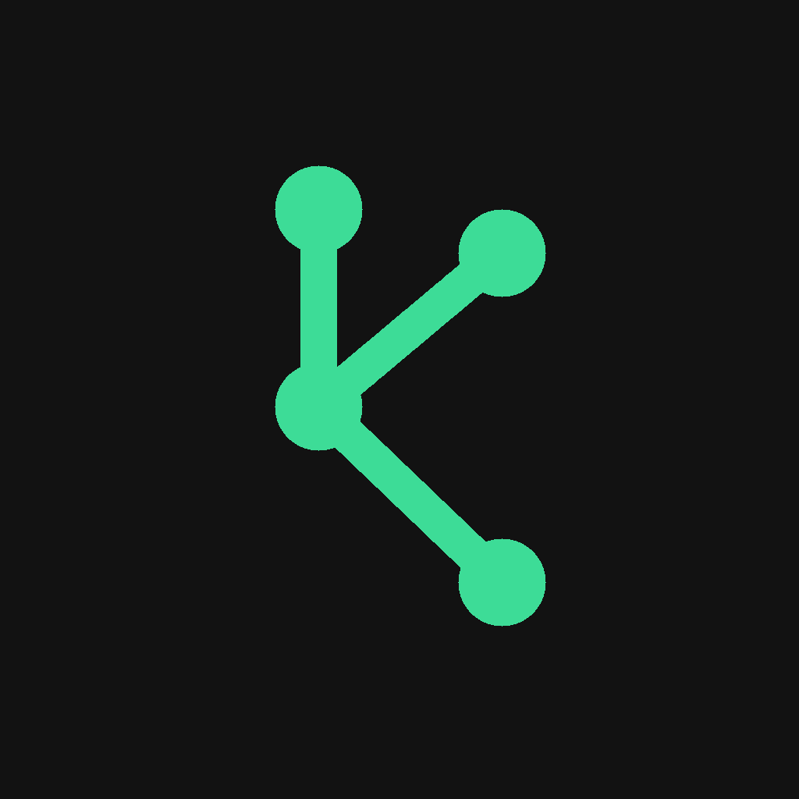
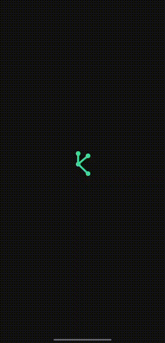
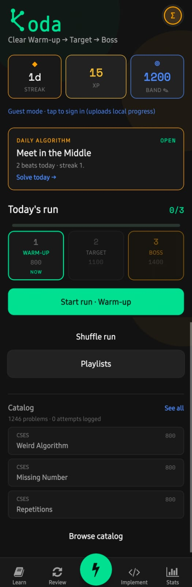
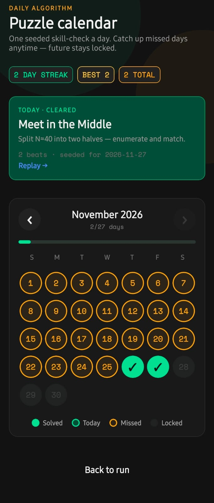
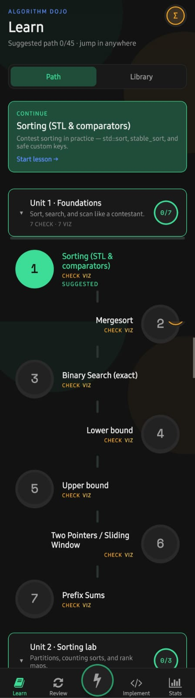
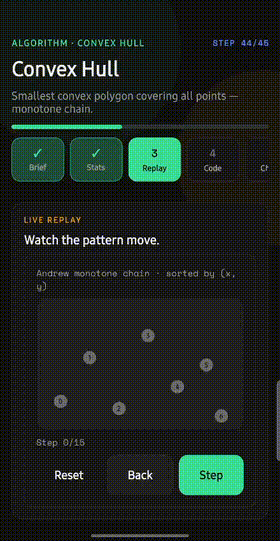
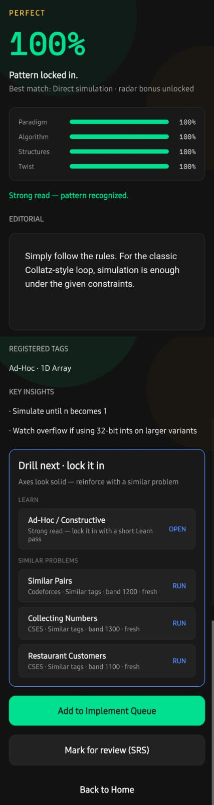
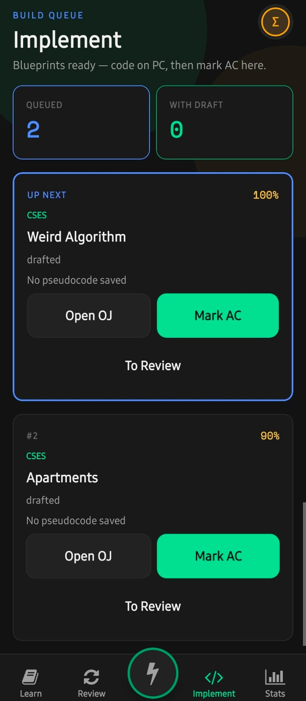
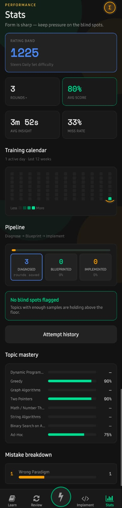

<p align="center">
  
</p>

<h1 align="center">Koda</h1>

<p align="center">
  <strong>Read. Diagnose. Blueprint.</strong><br/>
  Competitive programming training built for a phone — without writing syntax on glass.
</p>

<p align="center">
  
  
  
  
</p>

<p align="center">
  <em>Clear Warm-up → Target → Boss. Build judgment first. Code later on a real keyboard.</em>
</p>

---

## Launch

The brand opens as a graph: one node mitoses into a **K**, then **oda** slides in.

<p align="center">
  
</p>

---

## The Run tab

Home is one composition: wordmark, streak / XP / band, today’s algorithm, and the daily path.

<p align="center">
  
</p>

| Piece | Why it hits |
| --- | --- |
| **Graph-K wordmark** | Tap to replay the mitosis in place |
| **PlayerStrip** | Streak ◆ · XP gold count-up · Band ◎ |
| **Daily Path** | Warm-up → Target → Boss |
| **Raised Run orb** | Center tab bolt — mint when you’re on Home |

---

## Daily Algorithm

One seeded skill-check a day. Calendar like a habit game — streak, catch-up, +XP on first clear.

<p align="center">
  
</p>

---

## Learn — Algorithm Dojo

Curriculum as a path. Units, zigzag nodes, Check drills, and **Live Replay** visualizations — watch the algorithm move before you tag it.

<p align="center">
  
  &nbsp;
  
</p>

BFS · DFS · Dijkstra · knapsack · LIS · segtree · hull · and more.

---

## Encounter → Reveal

The core loop is diagnosis, not typing:

```text
Encounter  →  Radar  →  Hypothesis  →  Blueprint  →  Reveal
```

Read the statement. Tag complexity. Name paradigm, algorithm, structures, twists. Sketch a blueprint for later PC work. Then see how sharp your read was.

<p align="center">
  
</p>

Stuck? Progressive hints — coaching layers, not instant spoilers.

---

## Implement · Stats

Blueprints wait in the Build Queue until you AC them on a real OJ. Stats track band, heat, pipeline, and topic mastery.

<p align="center">
  
  &nbsp;
  
</p>

Also in the app: Review deck, catalog, playlists, history filters, offline SQLite catalog, guest → cloud sync when you want it.

---

## Why Koda

Most CP apps shove an editor onto a phone. Koda flips it:

1. **Train recognition** — paradigms and twists under time pressure  
2. **Keep implementation for a keyboard** — blueprints land in the Implement queue  
3. **Feel like a run** — daily set, streaks, bands, haptics, motion with purpose  

| | |
| --- | --- |
| **Mint** `#3DDC97` | Accents, Run orb, wordmark |
| **Gold** `#F0C14B` | XP |
| **Amber** `#F5A623` | Streak · Boss · Daily Algo |
| **Radar blue** `#5B8CFF` | Band · Constraint Radar |
| **Void** `#121212` | Stage |

Built with **Expo · React Native · Expo Router · Reanimated · Supabase** (optional) · local-first guest mode.

---

## Try it

Android preview builds ship as installable APKs via [EAS](https://expo.dev) (internal distribution).  
Repo stays private while the product is yours — share the build link, not the source.

```bash
npm install
npx expo start
```

Guest mode works with no backend. Optional sync: copy `.env.example` → `.env` and set Supabase keys.

<details>
<summary><strong>Dev notes</strong> (setup, scripts, ingest)</summary>

### Stack
- Expo (RN + Router), dark by default  
- Supabase Auth + Postgres, offline guest via SQLite / cache  

### Supabase
1. Enable Email auth  
2. Run migrations `001` … `005_io_formats.sql`  
3. Seed with `supabase/seed.sql` (`npm run generate:seed`)  
4. Redirect URLs: `koda://(auth)/reset`, `koda://(auth)/login`  

### Scripts

| Command | Purpose |
| --- | --- |
| `npm start` | Expo dev server |
| `npm run typecheck` | TypeScript |
| `npm test` | Scoring + habit + local-data |
| `npm run generate:seed` | Rebuild seed SQL |
| `npx eas-cli build --profile preview -p android` | Preview APK |

Ingest pipeline: [`scripts/ingest/README.md`](scripts/ingest/README.md).

</details>

---

<p align="center">
  <sub>Designed & built by <strong>João</strong> · graph-K brand · mint on void</sub>
</p>
